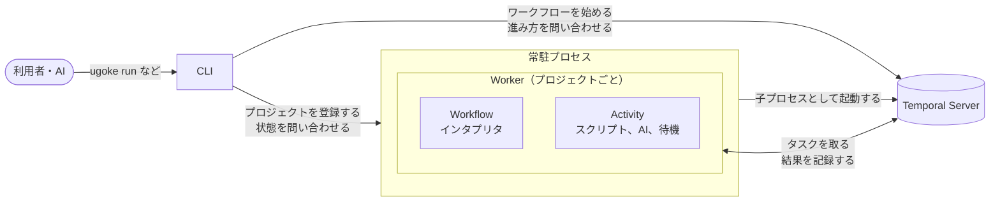
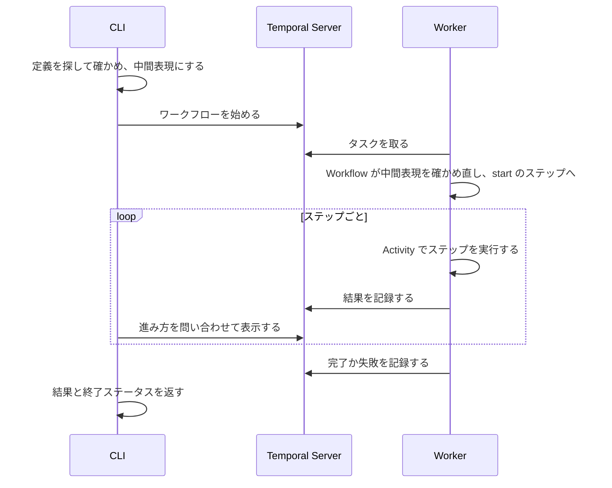
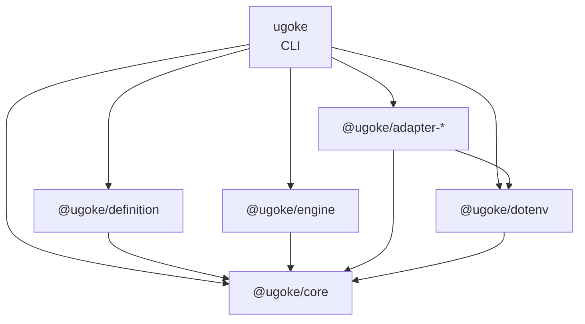

# アーキテクチャ

このページでは、ugoke がワークフローをどのように実行するかを説明します。使い方を順に知るには[ガイド](../guide/)を、コマンドや形式を引くには[リファレンス](../reference/)を読んでください。

## 全体の図

常駐プロセスがそのプロジェクトのステップを実行しないときは、`ugoke run` などのコマンドが、自分の中で一時的に Worker を動かします（「[Worker](#worker)」）。

ugoke は、ワークフローを [Temporal](https://temporal.io/) の Workflow として実行します。Temporal Server が実行の記録を持ち、Worker がその記録に沿ってステップを進めます。このため、ugoke のコマンドが終わっても、Worker があればワークフローは続きます。

## 登場人物

| 名前            | 役割                                                                                                                              |
| --------------- | --------------------------------------------------------------------------------------------------------------------------------- |
| CLI             | `ugoke` コマンドです。定義を確かめ、ワークフローを始め、進み方を表示します                                                        |
| 常駐プロセス    | `ugoke daemon start` で起動する、ホストに 1 つのプロセスです。Temporal Server を起動し、登録したプロジェクトの Worker を動かします |
| Temporal Server | ワークフローの実行の記録を持つサーバーです                                                                                        |
| Worker          | Temporal Server からタスクを取り、Workflow と Activity を実行します                                                               |
| Workflow        | 定義の中間表現を解釈し、ステップを順に進めます。外の世界には触れません                                                            |
| Activity        | スクリプトの実行、AI の呼び出し、待機など、外の世界に触れる処理です                                                               |
| プラグイン      | AI のプロバイダーや待機の方法を足します。`.ugoke/config.yaml` の `plugins` に書きます（「[プラグイン](../reference/plugins.md)」）                                              |

### Temporal Server

使う Temporal Server は、次の 2 種類です。

- 常駐プロセスが子プロセスとして起動する開発サーバー。実行の記録を残します
- `--address` や `.ugoke/config.yaml` の `temporal.address` で指定した、外の Temporal Server

開発サーバーは、ugoke がバージョンを決めて取得した Temporal CLI で起動します。

### Worker

Worker は、次のどちらかで動きます。

- 常駐プロセスの中。登録したプロジェクトごとに 1 つ動き、コマンドが終わってもステップを進めます
- コマンドの中。`ugoke run` などが一時的に動かします。コマンドが終わると止まります

コマンドの中で動くのは、常駐プロセスがステップを動かさないときです（「[使う Temporal Server](../reference/commands/run.md#使う-temporal-server)」）。

`ugoke run` の Ctrl+C の動き（「[ugoke run](../reference/commands/run.md#ctrlc)」）が、どこでステップを実行しているかで変わるのは、このためです。常駐プロセスの Worker がステップを実行しているときは、コマンドが離れても、ワークフローは続きます。

## ワークフローが動く流れ

1. CLI は、ワークフローの名前から定義のファイルを探し、形とステップのつながりを確かめて、中間表現にします。問題があれば、ここで止まります
2. CLI は、Temporal Server でワークフローを始めます。ワークフローの ID は `<ワークフロー名>-<UUID>` です
3. Worker は、Workflow を実行します。Workflow は、中間表現をもう一度確かめてから、`start` のステップから `next` をたどって進みます。分岐のあるステップでは、条件で行き先を選びます
4. ステップは、Activity として実行します。スクリプトと AI のステップは、1 度だけ試し、失敗するとワークフローを失敗させます。`continueOnError` を書いたステップは、失敗を結果として返し、ワークフローを続けます。ステップの出力は、Temporal の記録に載せず、実行ごとのイベントのログに書きます
5. CLI は、進み方を追いかけて表示し、ワークフローが終わると結果を返します。表示と終了ステータスは「[ugoke run](../reference/commands/run.md)」にあります

## 値の暗号化

Temporal を通る値は、ユーザーの鍵で暗号化します。ワークフローの入力、待機の答え、実行のメモなどです。Temporal Server には、読めない形で残ります。

ただし、ワークフローの ID と、失敗のメッセージは暗号化しません。ワークフローの ID には、ワークフローの名前が入ります。

鍵は、初めて使うときに ugoke が作ります。鍵は、コンピューターのユーザーごとに別です。

Worker は、その鍵で暗号化された値だけを受け付けます。暗号化されていない値、ほかの鍵の値、書き換えられた値は断ります。このため、Temporal Server に届く人でも、鍵がなければ、ステップを動かせません。ただし、履歴にある値をそのまま送り直すことは防げません。

ほかの鍵で始めた実行は、自分の Worker が動かしません。実行の一覧にも出ません。たとえば、同じ Temporal Server を使っても、ほかのコンピューターで始めた実行には戻れません。

鍵が壊れていると、鍵を使うコマンドは失敗します。ugoke は、壊れた鍵を作り直しません。鍵を失うと、その鍵で始めた実行は続けられません。

## パッケージの構成

ugoke のソースは、次のパッケージに分かれています。矢印は依存の向きです。

| パッケージ          | 役割                                                                                                          |
| ------------------- | ------------------------------------------------------------------------------------------------------------- |
| `@ugoke/core`       | 中間表現の型と、外の世界とのつなぎ目（Port）を持ちます。Temporal に依存しません                               |
| `@ugoke/definition` | 定義の読み込み、検証、中間表現への変換と、定義の図の文書の作成を担当します                                    |
| `@ugoke/engine`     | Workflow、Activity、Worker を持ちます。`@ugoke/core` だけに依存し、定義の読み込みや具体的な Adapter に依存しません |
| `@ugoke/dotenv`     | dotenv ファイルを読み込みます。Adapter と CLI から使います                                                            |
| `@ugoke/adapter-*`  | Port の実装です。スクリプトの実行、イベントのログ、端末での待機、AI、GitHub の待機などがあります              |
| `ugoke`             | CLI です。Adapter を組み立て、コマンドを提供します                                                            |

`@ugoke/adapter-ai-claude-code` と `@ugoke/adapter-wait-github` は、CLI が直接は使わず、プラグインとして読み込みます。
